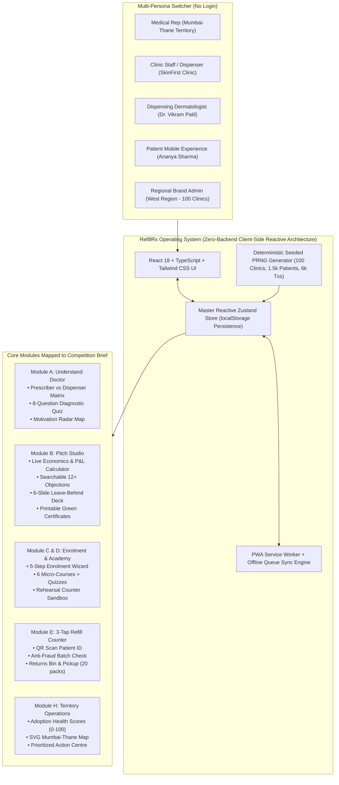

# RefillRx – A Full Refill-Program Operating Platform for Dispensing Dermatologists

**L'Oréal Sustainability Challenge 2026 • Medical Track**  
*Case: Engaging Dispensing Dermatologists*

---

## 1. Executive Summary & Strategic Narrative

About **45% of dermatologists in key markets are dispensing dermatologists**: they stock, recommend, and sell skincare directly from their clinics in a hybrid medical + retail channel. Standard FMCG refill schemes fail when presented to these doctors because they treat them as passive prescribers or expect them to act out of pure corporate philanthropy.

A dispensing dermatologist operates under a **dual mindset**:
1. **Clinician**: Demands uncompromising therapeutic efficacy, sterility, safety, formulation purity, and patient trust.
2. **Small-Business Owner**: Manages clinic margins, inventory holding costs, working capital risks, front-desk staff bandwidth, and competing brand trade schemes.

**RefillRx** solves this challenge end-to-end:
- **Practice Growth & Patient Loyalty**: Positions refills as a recurring adherence engine (+62% repeat rate) yielding +32% margin with zero dead-stock risk through a **100% Sale-or-Return guarantee**.
- **3-Tap Frictionless Execution**: An offline-capable mobile counter tool allowing receptionists to process refills in **under 25 seconds** with automated anti-fraud batch validation.
- **Territory Accountability**: A multi-factor **Adoption Health Score (0–100)** and automated Action Centre to ensure execution across 25 clinics in a medical rep's territory.

---

## 2. Solution Architecture



---

## 3. Competition Deliverables Breakdown

### Deliverable (a): Understand the Doctor (`/doctor-matrix`)
- **Prescriber vs. Dispenser Matrix**: Interactive side-by-side comparison across 8 drivers (Clinical Trust, Margin, Inventory Risk, Staff Load, Retention, Brand Support, Counterfeits, Sustainability) with 1–5 weight bars and explanatory tooltips.
- **Doctor Archetype Quiz (8 Questions)**: Evaluates doctor responses and diagnoses them into 5 archetypes (*Clinician-First Purist*, *Margin-Driven Entrepreneur*, *Patient Loyalty Builder*, *Eco-Conscious Pioneer*, *Time-Poor Pragmatist*).
- **Motivation Radar Chart**: Visualizes the archetype's driver weights across 5 axes and saves findings directly to the doctor's profile.

### Deliverable (b): In-Clinic Execution & Levers (`/counter`, `/academy`, `/levers`)
- **3-Tap Clinic Refill Counter**: Designed for peak OPD rush hours. Completes in **under 25 seconds**:
  1. *Step 1*: Patient ID via simulated QR scan or mobile number lookup.
  2. *Step 2*: Container integrity check + laser batch code entry with duplicate-pack anti-fraud detection.
  3. *Step 3*: 20% circular discount billing, payment mode (UPI/Cash/Card), staff PIN, and instant receipt.
- **Under-Counter Returns Bin**: Digital gauge tracking accumulated containers; automatically triggers courier reverse-logistics pickup upon reaching the 20-container threshold.
- **Staff Training Academy**: 6 bite-sized modules (<3 min each) covering counter flows, empty checks, and patient FAQs, backed by 3-question quizzes and a safe **Practice Simulator Sandbox**.
- **Execution Levers Engine**: Toggleable operational and financial levers (+7% extra margin, 100% sale-or-return guarantee, free eco-standees, WhatsApp reminders) with empirical lift tracking.

### Deliverable (c): Core Pitch & Economics Studio (`/pitch-studio`)
- **Clinic Economics Calculator**: Live sliders for patient volume, dispensing share, maintenance regimen %, doctor margins, and repeat rates.
- **Output P&L**: Proves that while selling refills at 20% patient discount, doctor percentage margin increases to 32%, driving **₹1.2L–₹1.5L in net incremental annual practice margin**.
- **12-Month Cumulative Cash Flow**: Recharts area visualization modeling setup payback within 1.2 months.
- **Objection Handling Library**: 12+ searchable objections (e.g. cannibalisation, staff busy, hygiene/authenticity, stuck inventory) answered with a structured 3-part framework: **Acknowledge → Evidence → Commercial Offer**.
- **6-Slide Leave-Behind Pitch Deck**: Clean fullscreen presentation mode.
- **Printable Assets**: In-browser generated framed "Green Certified Clinic" certificates, counter standees, and patient flyers.

### Deliverable (d): Territory Dashboard & Health Score (`/territory`)
- **Territory Coverage**: 25 dispensing dermatology practices in the Mumbai–Thane pilot territory.
- **Adoption Health Score (0–100)**: Transparent deterministic scoring based on 40% refill rate vs target, 25% weekly consistency, 20% stock availability, and 15% staff training engagement.
- **Stylized SVG Map**: Geographic schematic of Mumbai/Thane/Navi Mumbai with pins color-coded by health score.
- **Prioritized Action Centre**: Rule-based task generator flagging dormant clinics (10+ days without refills), low inventory thresholds, and full returns bins.
- **Visit Planner**: Weekly route planner with GPS check-in simulation and visit note logs.

---

## 4. Tech Stack & Engineering Highlights

- **Frontend**: React 18, Vite, TypeScript (strict mode), Tailwind CSS.
- **Routing**: React Router v6 (supports standard HTML5 History and HashRouter fallback for static hosting).
- **State Management**: Zustand with `localStorage` persistence and cross-tab reactive synchronization.
- **Data Visualizations**: Recharts (Area curves, Radar charts, Bar distributions).
- **Internationalization (`i18next`)**: English, हिन्दी (Hindi), and मराठी (Marathi) with live language toggle in top bar.
- **Offline / PWA**: Web Manifest + Service Worker caching static assets and queuing offline transactions until network reconnects.
- **AI Copilot**: In-app rule-based natural language assistant with intent matching, suggested prompts, and deep links into relevant screens.

---

## 5. Getting Started & Local Development

### Prerequisites
- Node.js version 18 or higher (v20+ recommended)
- npm version 9 or higher

### Installation & Run Commands
```bash
# Clone or navigate to the project directory
cd hackathon

# Install dependencies
npm install

# Start development dev server
npm run dev
```

Open your browser at `http://localhost:5173`.

### Quality & Verification Commands
```bash
# Run TypeScript strict type-check
npm run build

# Run Vitest test suite (14 unit, calculations, and smoke tests)
npm test

# Run ESLint code quality check
npm run lint
```

---

## 6. How to Swap in a Real Backend or LLM

### Data Service Layer
All data operations are decoupled through the Zustand store (`src/store/useAppStore.ts`) and calculations utility (`src/lib/calculations.ts`). To connect a Node.js/PostgreSQL/Supabase backend:
1. Replace localStorage setters in `src/store/useAppStore.ts` with standard `fetch()` or `axios` API calls pointing to your REST/GraphQL endpoints.
2. The data types and Zod schemas in `src/types/index.ts` already match standard relational database models (Clinics, Transactions, StockItems, ReturnPacks, Patients, Tasks).

### AI Copilot LLM Integration
The AI Copilot in `src/components/copilot/CopilotDrawer.tsx` currently uses an offline rule-based intent engine. To connect Gemini or OpenAI:
1. Create a `.env` file with `VITE_GEMINI_API_KEY=your_key_here`.
2. In `src/store/useAppStore.ts`, modify `sendCopilotMessage`:
```typescript
import { GoogleGenerativeAI } from '@google/generative-ai'
const genAI = new GoogleGenerativeAI(import.meta.env.VITE_GEMINI_API_KEY)
// Stream model responses passing live store state as system context
```

---

## 7. Public Deployment Instructions (No Login Required)

The build output in `dist/` is 100% static and ready for instant deployment to any public hosting platform.

### Option A: Vercel (Recommended)
`vercel.json` is pre-configured with SPA route rewrites:
```bash
npm install -g vercel
vercel deploy --prod
```

### Option B: Netlify
`netlify.toml` is pre-configured with redirect rules:
```bash
npm install -g netlify-cli
netlify deploy --prod --dir=dist
```

### Option C: GitHub Pages
Set the environment variable `VITE_USE_HASH_ROUTER=true` before building to enable `#` hash routing for static subpath hosting:
```bash
export VITE_USE_HASH_ROUTER=true
npm run build
npx gh-pages -d dist
```

---

## 8. Competition Documents Reference
- `PLAN.md`: Initial architecture and build order.
- `ASSUMPTIONS.md`: Full catalog of quantitative parameters, unit economics, and health score math.
- `DEMO_SCRIPT.md`: 3-minute oral script mapping every click to deliverables (a), (b), (c), and (d).
- `SCREENSHOTS.md`: Checklist of the 8 best screens to capture for presentation slide decks.

